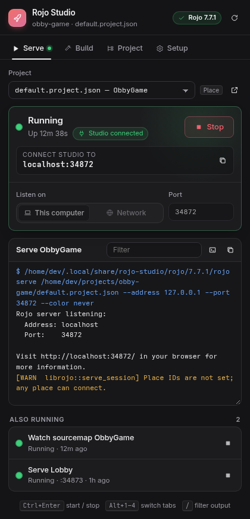
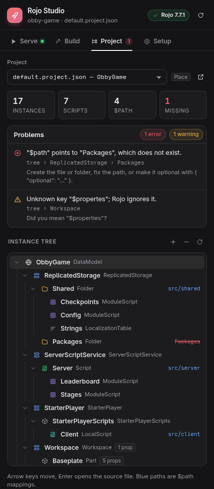
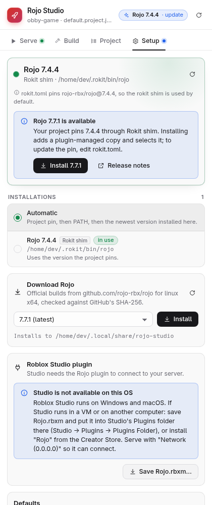
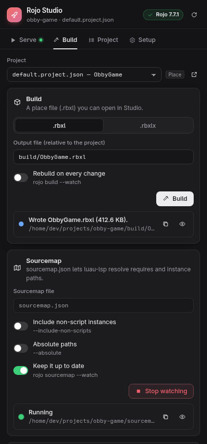
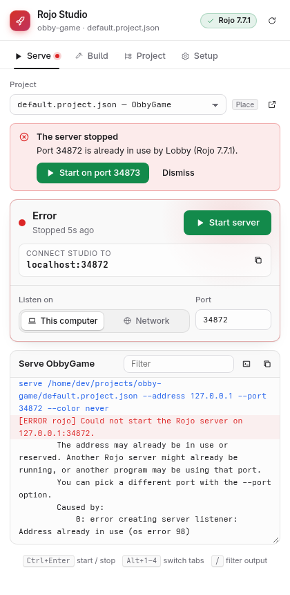
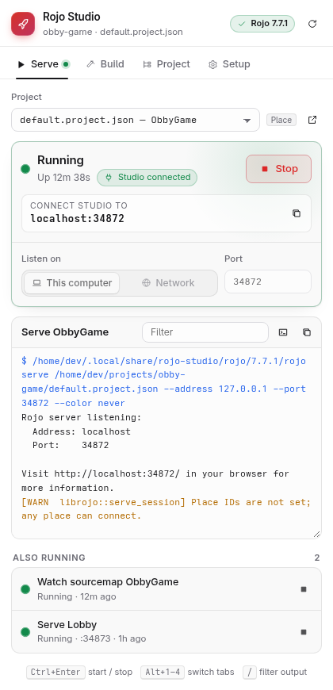

# Rojo Studio for Orca

Rojo for Roblox, inside Orca. Install Rojo with one click, start and stop `rojo serve` with live
output and a connected-Studio indicator, build `.rbxl`/`.rbxm` files, keep `sourcemap.json` fresh
for luau-lsp, create new projects, and see the Roblox instance tree your `*.project.json` maps to,
with a linter that explains what is wrong.

It works with any Rojo project you open in Orca. Nothing is tied to a particular game or machine.

> Rojo Studio is an independent, unofficial plugin. It is not made by or affiliated with the Rojo
> project or Roblox Corporation; "Rojo" and "Roblox" are named only to say what it works with.
> It downloads the official Rojo releases from github.com/rojo-rbx/rojo.

| Serve (dark) | Project tree (dark) | Setup (light) |
| --- | --- | --- |
|  |  |  |

| Build (dark) | Port in use (light) | Serve (light) |
| --- | --- | --- |
|  |  |  |

## Features

**Rojo, installed for you**
- Finds every Rojo on the machine: plugin-managed versions, `PATH`, Rokit / Aftman / Foreman shims,
  `cargo install`, or a path you set. A `rokit.toml` / `aftman.toml` / `foreman.toml` that pins Rojo
  is respected: its shim is used by default.
- Downloads any official release for your OS and CPU (latest by default, prereleases optional),
  checks it against the SHA-256 digest GitHub publishes, unpacks it into the plugin's own data
  folder and selects it. Older versions stay installed; switch or remove them in one click.
- Tells you when a newer Rojo is out (checked at most hourly; can be turned off).

**Serve**
- Start / stop `rojo serve` for the focused workspace's project (`default.project.json` or any
  `*.project.json`; the picker lists all of them).
- Listen on *This computer* (127.0.0.1) or *Network* (0.0.0.0) for Studio in a VM or on another
  computer; the panel then lists your LAN addresses. Port per project, defaulting to the project's
  `servePort` or 34872.
- Live status (starting, running, stopping, error) with uptime, the address to connect Studio to
  with a copy button, and a **Studio connected** indicator.
- Port-in-use detection *before* you start: it names what holds the port (another Rojo server and
  its project, or one of your own servers) and offers the next free port in one click.
- Several servers at once (one per project), each with its own output; all of them in the status
  bar and an "Also running" list.
- Live, filterable output with error and warning highlighting; copy the output or the exact
  command line.
- Desktop notification when a server or watcher fails.

**Build and sourcemap**
- `rojo build` to `.rbxl`, `.rbxlx`, `.rbxm` or `.rbxmx`, with the output path remembered per
  project and checked against the project kind (a place cannot become a model file). Optional
  `--watch`.
- `rojo sourcemap` with `--include-non-scripts`, `--absolute` and `--watch`; optionally started
  together with every server (setting), so luau-lsp always has a fresh `sourcemap.json`.

**Project**
- The instance tree your project file produces, following Rojo's sync rules: services,
  `$path` mappings (shown in blue), `init.*` scripts, `.server`/`.client` scripts, `.model.json`,
  `.csv`, `.txt`, nested projects and more. Keyboard navigation; Enter opens the source file.
- A linter for the project file: JSON-with-comments syntax errors with line and column, missing
  `$path` targets, unknown keys with "did you mean", instances without `$className`, invalid
  `servePort`, backslashes in paths, and more, each with a hint.
- **New project**: `rojo init` with the place, model or plugin template into any folder.
- Recent projects across workspaces.

**Roblox Studio plugin**
- Windows and macOS: *Install into Studio* runs `rojo plugin install` (the plugin that matches
  your Rojo version).
- Everywhere: *Save Rojo.rbxm…* downloads the official plugin file of your Rojo version, for Studio
  in a VM or on another computer. Linux gets clear guidance, since Studio does not run there.

**Everywhere in Orca**
- Status bar item: `Rojo :34872 ●` while serving (● = Studio connected), red on errors.
- Command palette: *Rojo: Start or stop the server*, *Stop all servers and watchers*,
  *Build the selected project*, *Generate sourcemap.json*, *Show or hide the panel*.
- Follows Orca's light and dark themes, and any custom theme, through Orca's theme variables.
- Keyboard: `Alt+1…4` switch tabs, arrow keys move between tabs, `Ctrl/⌘+Enter` starts or stops
  the server (Serve) or builds (Build), `/` filters the output.

## Requirements

- Orca **1.4.260** or newer, desktop app (the panel uses Orca's isolated plugin frames).
- Rojo 7 (installed by the plugin if you have none). Remote (SSH) workspaces need `rojo` installed
  on that host.

## Install

The plugin has no build step and no npm dependencies: Orca runs its TypeScript directly.

**Development folder** (to try it or change it):

- Orca → Settings → Plugins → *Turn on plugins* → *Development folders…* → add this folder, then
  review and enable it, or
- `orca plugin dev load /path/to/rojo-studio` (prints the fingerprint to approve with `--approve`).

**From the zip or a folder** (unpack the zip first; `orca-plugin.json` sits at its root):

```sh
orca plugin install /path/to/rojo-studio-0.1.0          # prints the permissions and a fingerprint
orca plugin enable local.rojo-studio --approve <fingerprint>
```

Orca asks you to approve what the plugin may do (see [Permissions](#permissions)) before anything
runs.

## Use

1. Open a folder or workspace with a Rojo project in Orca and click the **Rojo Studio** icon
   (rocket) in the right sidebar, or press the **Rojo** item in the status bar.
2. No Rojo yet? The **Setup** tab installs the latest release in one click.
3. **Serve** → *Start server*. In Roblox Studio, open the Rojo plugin and press *Connect* with
   the address shown (`localhost:34872` by default). The indicator turns to *Studio connected*.
4. **Build** → pick the format and press *Build* (or turn on *Rebuild on every change*).
   Generate or watch `sourcemap.json` below it.
5. **Project** shows the instance tree and any problems in the project file. *New project* creates
   one from a template.

Studio in a VM or on another computer: choose *Network* before starting, connect Studio to one
of the listed LAN addresses, and install the Studio plugin there with *Save Rojo.rbxm…*.

## Settings

Orca → Settings → Plugins → Rojo Studio:

| Setting | Default | What it does |
| --- | --- | --- |
| Default server address | This computer | `localhost` (127.0.0.1) or `0.0.0.0` for new servers |
| Default port | 34872 | Used when the project has no `servePort` |
| Run Rojo in | Automatic | Background process (this computer) or Orca terminal (remote workspaces) |
| Path to rojo | empty | Use this executable instead of picking one automatically |
| Watch sourcemap.json while serving | off | Also runs `rojo sourcemap --watch` with every server |
| Notify when a server or watcher fails | on | Desktop notification on failures |
| Check GitHub for new Rojo releases | on | At most once an hour |
| Offer Rojo prereleases | off | Lists release candidates too |

Host and port per project, build and sourcemap paths are remembered per project file.

## Permissions

| Capability | Why |
| --- | --- |
| `workspace:read` | Find the focused workspace's folder and follow focus changes |
| `workspace:write` | Only `editor.open`: open the project file and source files from the tree |
| `terminal:send`, `terminal:read` | Run Rojo in an Orca terminal for remote workspaces and follow its output |
| `storage:own`, `settings:own` | Remember choices; read the plugin's settings |
| `notifications:show` | Tell you when a server fails |

Network: the worker talks to `api.github.com` and GitHub's download host (release list, Rojo
archives, `Rojo.rbxm`) and to `127.0.0.1:<port>` (to see whether a busy port is a Rojo server).
Nothing else, no telemetry, nothing about you is sent. Data lives in
`~/.local/share/rojo-studio` (Linux), `~/Library/Application Support/RojoStudio` (macOS) or
`%LOCALAPPDATA%\RojoStudio` (Windows).

## Limitations

- Servers are child processes of the plugin's worker: disabling, updating or restarting the
  plugin (or quitting Orca) stops them.
- Remote (SSH) workspaces run Rojo in an Orca terminal on that host: no tree, linter or port
  check there, the connected-Studio indicator is not shown, and the project file path is typed.
- *Studio connected* counts hosts with an open TCP connection to the server; two Studio windows
  on the same computer show as one.
- `rojo plugin install` exists only on Windows and macOS (Rojo's own limitation).
- The panel needs the Orca desktop app; browser clients (`orca serve`) are not supported.

More background, the APIs used and the trade-offs are in [HOWTO.md](HOWTO.md).

## Development

```sh
./build.sh                       # typings, tsc, validate, unit + worker tests, check, package
ROJO_STUDIO_E2E=1 ./build.sh     # also downloads the real Rojo and runs init/serve/build/sourcemap
```

`python3 tools/make_icon.py` redraws `assets/icon.png` (the script lives in the source folder, not in the package).

## License

MIT
